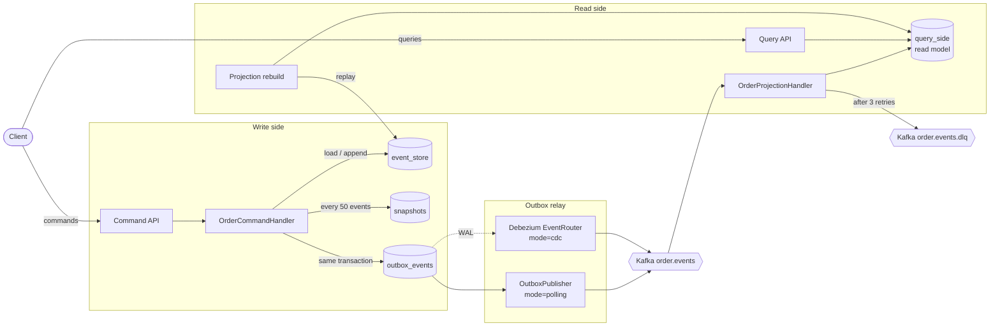

# Order Management System

[](https://github.com/bogdanbs/order-management-system/actions/workflows/ci.yml)

A Spring Boot order service demonstrating event sourcing, an outbox, Kafka projections, PostgreSQL, and a Kubernetes deployment.

## Run locally

Requirements: Java 21 or later, Maven, and Docker Compose.

```bash
mvn -pl order-service test   # unit and slice tests
mvn verify                   # plus Testcontainers integration tests (needs Docker)
docker compose up --build
```

The local Compose demo uses `orders_pass` for PostgreSQL and `admin` for Grafana when no environment variables are set. These are demo-only defaults. Set `ORDERS_DB_PASSWORD` and `GRAFANA_ADMIN_PASSWORD` before starting Compose to use different values. Grafana is available at <http://localhost:3001>; the order API is at <http://localhost:8090>; Alertmanager is at <http://localhost:9093>.

To receive alerts in Slack, set `SLACK_WEBHOOK_URL` to a [Slack incoming webhook](https://api.slack.com/messaging/webhooks) URL before starting Compose. Without it the stack runs normally, and Alertmanager logs failed notification attempts.

## Order API

- `POST /api/orders` creates an order.
- `GET /api/orders/customer?firstName=Ada&lastName=Lovelace` returns orders matching a customer's first and last name, newest first (case-insensitive).
- `GET /api/orders` lists all orders.
- `POST /api/orders/{id}/items` adds a product and quantity.
- `DELETE /api/orders/{id}/items/{productId}` removes one unit. The line remains until its quantity reaches zero.
- `POST /api/orders/{id}/submit` submits the order.
- `POST /api/orders/{id}/confirm-payment` confirms payment only when the amount exactly matches the order total. Repeating the same payment ID and amount is idempotent; another payment after confirmation is rejected.

Kafka projection processing retries failed events three times after the initial attempt, then publishes them to `order.events.dlq`. Database changes and the processed-event marker share a transaction; the consumer offset advances only after successful processing.

## Architecture



### Why event sourcing, CQRS, and an outbox

- **Event sourcing.** The `Order` aggregate is rebuilt from its events, not loaded from a mutable row. Every state change is kept with its business meaning (`OrderItemRemoved`, `OrderPaymentConfirmed`), which gives an audit trail, makes `GET /api/orders/{id}/events` possible, and lets read models be rebuilt from history. Concurrent writers are detected through the unique `(aggregate_id, sequence_number)` key and retried. Snapshots bound replay cost, and upcasters (`OrderCreated` v1 → v2) let the event schema evolve without rewriting stored events.
- **CQRS.** Writes validate invariants on the aggregate; reads hit denormalized tables shaped for queries, such as the customer-name lookup. The two sides scale and change independently, and a broken projection can be fixed and replayed through `POST /admin/projections/rebuild`.
- **Transactional outbox.** Events are written to the event store and the outbox in one PostgreSQL transaction. That avoids the dual-write problem: an event is never committed without eventually reaching Kafka, and nothing reaches Kafka for a rolled-back command. Delivery is at-least-once, so the projection deduplicates by event ID (`processed_events`) in the same transaction as its read-model update.

### Polling vs. CDC

The relay is selected with `APP_OUTBOX_MODE` (`polling` by default, or `cdc`).

| | Polling (`OutboxPublisher`) | CDC (Debezium) |
|---|---|---|
| Moving parts | Only the service, PostgreSQL, and Kafka | Kafka Connect, a logical replication slot, `wal_level=logical` |
| Latency | Up to the polling interval (5 s) | Near real time, from the WAL |
| Database load | Periodic `SELECT … FOR UPDATE SKIP LOCKED` on the outbox | Reads the WAL; no queries against the outbox table |
| Outbox bookkeeping | Rows marked `PUBLISHED` or `FAILED` after 5 attempts; `PUBLISHED` rows deleted 24 h after publishing, `FAILED` rows kept for inspection | Rows deleted 24 h after creation; Debezium's EventRouter ignores the deletes |
| Operations | Easy to run and debug locally | Connector and slot must be monitored; a stopped connector retains WAL |

`OutboxCleanup` runs hourly in both modes; the retention is set with `app.outbox.retention-hours`.

Polling is the default because it works without extra infrastructure and is easy to reason about. CDC suits higher throughput and lower latency once Kafka Connect is operated anyway.

### Known limitations

- **Polling outbox across replicas.** Pollers claim a batch in a short `FOR UPDATE SKIP LOCKED` transaction, then send to Kafka after database locks are released. Claims left in `IN_FLIGHT` by a crashed process are retried after five minutes. Per-aggregate sequence numbers preserve event order across replicas.
- **Events that end up `FAILED`.** A failed send holds back the aggregate's later events until it succeeds on retry. After five failed attempts the event is marked `FAILED` and skipped, and the aggregate's later events are published without it. `FAILED` rows are never deleted automatically; the gauge `outbox_records_failed` (refreshed every 30 s, `app.outbox.metrics-refresh-ms`) counts them. The Prometheus alert `OutboxRecordsFailed` (`infrastructure/prometheus/alerts.yml`) fires once the count has been above zero for a minute, and the Grafana dashboard *Order Service — Outbox* shows it. Alertmanager posts firing and resolved alerts to Slack, repeating every 4 h while they last.
- **At-least-once delivery.** The poller sends to Kafka before its transaction commits; a crash in between republishes the batch. Consumers must stay idempotent.
- **Eventual consistency.** Query endpoints may briefly return stale data after a command succeeds.

## How this project was built

This project was developed with [Claude Code](https://claude.com/claude-code) and extended with GitHub Copilot.

## Kubernetes

See [`k8s/README.md`](k8s/README.md) for image build, secret setup, deployment, and service access instructions. Create credentials from the checked-in `k8s/01-secrets.yaml.example` template; do not commit rendered secrets.
